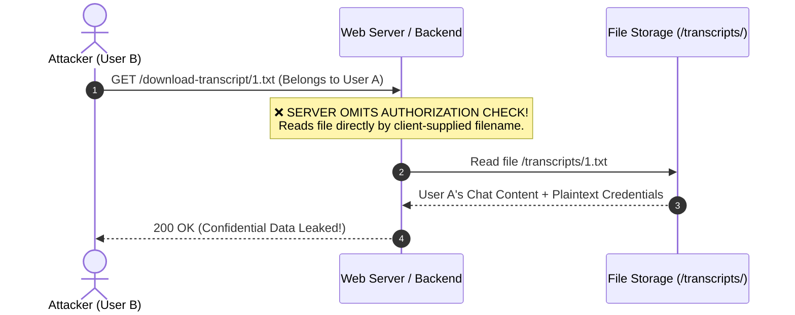

# Broken Access Control: Accessing Private User Data (IDOR & BOLA)

**IDOR (Insecure Direct Object References)**, now commonly standardized under **BOLA (Broken Object Level Authorization)** in modern API security (ranked **#1 on the OWASP API Security Top 10**), is one of the most widespread and severe vulnerabilities within the _Broken Access Control_ category.

This flaw occurs when an application exposes a direct reference to internal files or database records (such as user profiles, chat transcripts, invoices, private documents, or payment transactions) based on client-controlled parameters, **without verifying on the server side whether the authenticated user has permission to access that object**.

---

## 1. Core Concept: Why Does IDOR Occur?

IDOR consists of two key components:

1. **Direct Object Reference:** The application exposes an internal object identifier (such as a filename `1.txt`, database primary key `user_id=105`, or invoice number `INV-001`) directly in user-modifiable parameters.
2. **Insecure (Missing Authorization):** The backend server fulfills the request strictly using the provided ID, without validating whether the requested resource belongs to the currently authenticated session.


---

## 2. When is Changing an ID an IDOR vs. Intended Normal Behavior?

Not every parameter that can be modified is an IDOR vulnerability. The fundamental distinction lies in **data privacy and authorization boundaries**:

| Scenario | Example Request | Status | Rationale |
| :--- | :--- | :--- | :--- |
| **Intended Behavior (Not IDOR)** | `GET /shop?seller_id=10` <br /> `GET /blog/post?id=25` <br /> `GET /profile/elonmusk` | ✅ **Safe (Public)** | The data is designed to be **publicly accessible** by anyone without permission constraints. |
| **Vulnerability (IDOR / BOLA)** | `GET /invoice/download?id=105` <br /> `GET /chat/transcript/1.txt` <br /> `POST /api/user/delete?id=8` | ❌ **Vulnerable (IDOR)** | The resource or action is **private/restricted**. Other users must never view or manipulate it without authorization. |

> [!IMPORTANT]
> **Key Rule:** An IDOR only exists when the accessed object or action **should be restricted** to its owner or authorized roles, yet the server fails to enforce this check.

---

## 3. The Three Action Categories of IDOR


### 1. Read IDOR (Viewing Confidential Data)
Attackers can view private information belonging to other users, such as banking statements, medical histories, chat archives, or credit card details.
```http
GET /api/v1/users/105/billing-history HTTP/1.1
Authorization: Bearer <attacker_token>
```

### 2. Write / Modify IDOR (Tampering with Other Users' Data)
Attackers can mutate victim records. In severe scenarios, this leads to **Account Takeover** by changing the victim's email or phone number:
```http
PUT /api/v1/users/update-email HTTP/1.1
Authorization: Bearer <attacker_token>
Content-Type: application/json

{
  "target_user_id": 102,
  "new_email": "attacker@evil.com"
}
```

### 3. Delete IDOR (Deleting Victim Resources)
Attackers can delete orders, accounts, or support tickets owned by another customer:
```http
DELETE /api/v1/documents/delete?doc_id=8842 HTTP/1.1
```

---

## 4. Real-World Case Study: Why File & Chat Transcript Endpoints Are Often Vulnerable

In a classic learning scenario (such as the PortSwigger Web Security Academy Live Chat lab):

1. **Sequential File Storage:**
   The customer support chat system writes transcripts to disk sequentially: `1.txt`, `2.txt`, `3.txt`.
2. **Victim Scenario:**
   The first user (`1.txt`, e.g., Carlos) chatted with a support bot asking for password recovery. The chatbot sent a temporary password in plain text within the chat transcript.
3. **Tester Exploitation:**
   When an attacker begins a new chat session, they receive an option to download their transcript:
   ```http
   GET /download-transcript/2.txt HTTP/1.1
   ```
   The attacker intercepts the request in Burp Suite and changes `2.txt` to `1.txt`.
4. **Backend Oversight:**
   Because the backend reads the requested file directly without checking session ownership, Carlos's chat log and password are sent straight to the attacker!



Identical real-world vulnerabilities frequently occur in:
- **Invoice & Receipt Downloads:** `GET /invoices/INV-2026-0012.pdf`
- **Support Ticket Attachments (ID Photos):** `GET /attachments/ticket_402_id.jpg`
- **Financial Statement Exports:** `GET /export/report?account_id=550`

---

## 5. Where Are Object Parameters Located?

IDOR parameters can appear in various parts of an HTTP request:

| Parameter Location | Vulnerable Request Example |
| :--- | :--- |
| **URL Query String** | `GET /account/details?account_id=1054` |
| **REST API URL Path** | `GET /api/v1/users/882/credit-cards` <br /> `GET /download-transcript/1.txt` |
| **Request Body (JSON / XML)** | `PUT /api/orders/cancel` <br /> `{"order_id": 9921}` |
| **Custom HTTP Headers** | `X-User-Id: 102` <br /> `X-Account-Number: ACC-9942` |

---

## 6. Practical Testing Methodology (Two-Account Approach)

To test for IDOR systematically and ethically:

### Step 1: Set Up Two Test Accounts
- **Account A (Tester / Attacker):** `user_id = 101`
- **Account B (Victim):** `user_id = 102`

### Step 2: Capture Private Resource Requests
Log in as **Account A**, perform an action accessing private data (view transcript, order history, billing), and capture the request in **Burp Suite**:
```http
GET /api/orders/5501 HTTP/1.1
Host: target-website.com
Cookie: session_token=token_user_a_xyz
```

### Step 3: Swap the Object Identifier
Replace object ID `5501` (owned by Account A) with object ID `5502` (owned by Account B), while retaining Account A's session token:
```http
GET /api/orders/5502 HTTP/1.1
Host: target-website.com
Cookie: session_token=token_user_a_xyz
```

### Step 4: Evaluate the Server Response
- **Secure (`403 Forbidden` / `404 Not Found`):** The server refuses the request because Account A does not own object `5502`.
- **Vulnerable (`200 OK` with Account B's data):** IDOR is confirmed!

---

## 7. Security Impact

1. **Mass PII Harvesting:** Automated scripts can iterate sequential IDs from `1` to `1,000,000` to dump entire databases.
2. **Account Takeover:** Modifying another user's recovery email or phone number via Write IDOR.
3. **Regulatory Non-Compliance:** Severe penalties under GDPR, HIPAA, and national data privacy laws.

---

## 8. Prevention & Remediation (Best Practices)

### 1. Enforce Object-Level Authorization on the Server

Never rely on client-supplied IDs without validating ownership against the currently authenticated session:

```typescript
// ❌ VULNERABLE (IDOR):
app.get("/api/orders/:orderId", authenticateUser, async (req, res) => {
  // Queries purely by the orderId parameter
  const order = await db.order.findUnique({
    where: { id: req.params.orderId },
  });

  if (!order) return res.status(404).send("Not Found");
  return res.json(order); // Any authenticated user can view ANY order!
});

// ✅ SECURE (Enforces Session Ownership):
app.get("/api/orders/:orderId", authenticateUser, async (req, res) => {
  const currentUserId = req.user.id; // Extracted from verified JWT / Session

  // Query strictly couples the object ID with the authenticated user ID
  const order = await db.order.findFirst({
    where: {
      id: req.params.orderId,
      userId: currentUserId, // Must belong to authenticated user!
    },
  });

  if (!order) {
    // Return 404 instead of 403 to prevent object existence enumeration
    return res.status(404).json({ error: "Order not found." });
  }

  return res.json(order);
});
```

---

### 2. Validate Access to Static Files / Chat Transcripts

For physical files (such as chat transcripts or PDF invoices), check relational permissions before serving the file:

```typescript
// ✅ Secure File Download Endpoint
app.get("/download-transcript/:fileName", authenticateUser, async (req, res) => {
  const currentUserId = req.user.id;
  const fileName = req.params.fileName;

  // Verify that this transcript belongs to the requesting user
  const transcriptRecord = await db.chatTranscripts.findFirst({
    where: {
      fileName: fileName,
      userId: currentUserId,
    },
  });

  if (!transcriptRecord) {
    return res.status(404).json({ error: "Transcript not found." });
  }

  return res.sendFile(`/secure/storage/transcripts/${fileName}`);
});
```

---

### 3. Utilize Non-Sequential Identifiers (UUID v4 / NanoID)

Replace predictable incremental IDs (`1, 2, 3...`) with cryptographically random UUIDs (`550e8400-e29b-41d4-a716-446655440000`).

> [!TIP]
> **Key Note:** UUIDs prevent trivial brute-force enumeration attacks, but **are not an alternative to access control**. Server-side ownership validation is still strictly mandatory.
