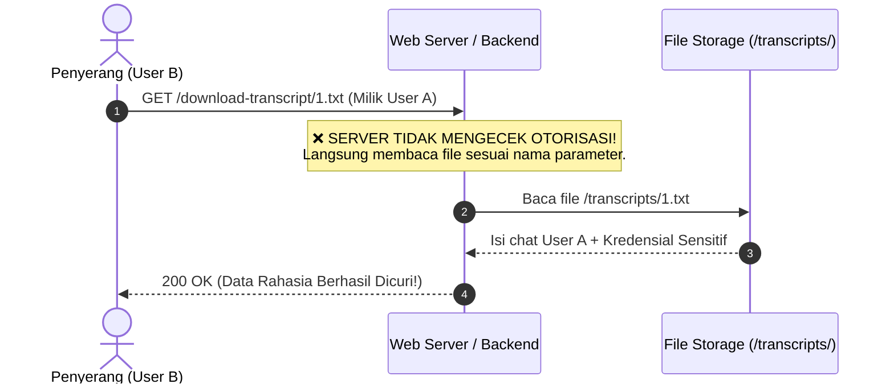

# Broken Access Control: Mengakses Data Pribadi Pengguna (IDOR & BOLA)

**IDOR (Insecure Direct Object References)** atau yang dalam standar keamanan API modern dikenal sebagai **BOLA (Broken Object Level Authorization)** adalah salah satu bentuk paling umum dan berbahaya dari kerentanan _Broken Access Control_ (menempati peringkat **#1 di OWASP API Security Top 10**).

Celah ini terjadi ketika aplikasi web menyediakan akses langsung ke file atau objek database (seperti profil, riwayat chat, invoice, dokumen, atau transaksi) berdasarkan parameter input dari pengguna, **tanpa memverifikasi di sisi server apakah pengguna yang sedang login berhak mengakses objek tersebut**.

---

## 1. Konsep Dasar: Mengapa IDOR Terjadi?

Konsep IDOR terdiri dari dua unsur utama:

1. **Direct Object Reference (Referensi Objek Langsung):** Aplikasi mengekspos pengenal internal objek (seperti nama file `1.txt`, ID database `user_id=105`, nomor invoice `INV-001`) langsung ke parameter yang dapat diubah pengguna.
2. **Insecure (Tidak Aman / Tanpa Otorisasi):** Server langsung memproses dan mengambil data objek tersebut hanya berdasarkan ID yang dikirim klien, tanpa mengecek kepemilikan objek terhadap sesi pengguna yang sedang login.


---

## 2. Kapan Mengganti ID Termasuk IDOR vs Fitur Normal?

Banyak orang mengira setiap parameter yang bisa diganti nilainya adalah IDOR. Kuncinya terletak pada **batasan privasi dan otorisasi data**:

| Skenario | Contoh Request | Status | Penjelasan |
| :--- | :--- | :--- | :--- |
| **Fitur Normal (Bukan IDOR)** | `GET /shop?seller_id=10` <br /> `GET /blog/post?id=25` <br /> `GET /profile/elonmusk` | ✅ **Aman (Intended)** | Data tersebut memang didesain **publik** dan boleh dilihat oleh siapapun tanpa batasan hak akses. |
| **Celah Keamanan (IDOR / BOLA)** | `GET /invoice/download?id=105` <br /> `GET /chat/transcript/1.txt` <br /> `POST /api/user/delete?id=8` | ❌ **Vulnerable (IDOR)** | Objek atau aksi tersebut bersifat **privat / rahasia**. User lain tidak boleh mengakses atau memanipulasinya tanpa hak otorisasi. |

> [!IMPORTANT]
> **Kunci Penentu:** IDOR baru terjadi jika objek/tindakan yang diakses **seharusnya dibatasi** untuk pemiliknya atau role tertentu, namun server mengabaikan pemeriksaan otorisasi tersebut.

---

## 3. Tiga Kategori Aksi pada IDOR


### 1. Read IDOR (Membaca Data Sensitif)
Penyerang dapat mengintip data pribadi pengguna lain, seperti mutasi rekening, riwayat chat, rekam medis, atau informasi kartu kredit.
```http
GET /api/v1/users/105/billing-history HTTP/1.1
Authorization: Bearer <token_user_attacker>
```

### 2. Write / Modify IDOR (Mengubah Data Pengguna Lain)
Penyerang memodifikasi data milik pengguna lain. Skenario terparah adalah **Account Takeover** dengan mengganti email atau nomor HP korban:
```http
PUT /api/v1/users/update-email HTTP/1.1
Authorization: Bearer <token_user_attacker>
Content-Type: application/json

{
  "target_user_id": 102,
  "new_email": "attacker@evil.com"
}
```

### 3. Delete IDOR (Menghapus Resource Milik Korban)
Penyerang menghapus pesanan, dokumen, atau tiket support milik pengguna lain:
```http
DELETE /api/v1/documents/delete?doc_id=8842 HTTP/1.1
```

---

## 4. Studi Kasus Nyata: Mengapa Skenario File & Transkrip Chat Sering Rentan?

Dalam salah satu skenario klasik (seperti pada lab PortSwigger Web Security Academy):

1. **Penyimpanan Berurutan (_Sequential Storage_):**
   Sistem customer support / live chat menyimpan berkas percakapan di server lokal dengan nama berurutan: `1.txt`, `2.txt`, `3.txt`.
2. **Skenario Percakapan Korban:**
   Pengguna pertama (`1.txt`, misal Carlos) menghubungi support bot untuk menanyakan atau me-reset password. Chatbot memberikan password sementara di dalam riwayat chat tersebut.
3. **Eksploitasi Penguji:**
   Saat penyerang memulai chat baru, sistem memberikan opsi unduh transkrip:
   ```http
   GET /download-transcript/2.txt HTTP/1.1
   ```
   Penyerang mencegat (*intercept*) request di Burp Suite dan mengganti `2.txt` menjadi `1.txt`.
4. **Kelalaian Backend:**
   Karena server hanya membaca file berdasarkan parameter string tanpa mengecek sesi pemilik percakapan, isi chat Carlos beserta password-nya langsung terkirim ke penyerang!



Skenario serupa di dunia nyata sering ditemukan pada:
- **Download Invoice / Kuitansi:** `GET /invoices/INV-2026-0012.pdf`
- **Lampiran Tiket Support / Verifikasi KTP:** `GET /attachments/ticket_402_ktp.jpg`
- **Ekspor Laporan Keuangan:** `GET /export/report?account_id=550`

---

## 5. Di Mana Saja Parameter Objek IDOR Ditemukan?

IDOR tidak terbatas pada parameter URL saja. Parameter objek rentan dapat berada di berbagai bagian request HTTP:

| Lokasi Parameter | Contoh Request Rentan |
| :--- | :--- |
| **URL Query String** | `GET /account/details?account_id=1054` |
| **REST API URL Path** | `GET /api/v1/users/882/credit-cards` <br /> `GET /download-transcript/1.txt` |
| **Request Body (JSON / XML)** | `PUT /api/orders/cancel` <br /> `{"order_id": 9921}` |
| **Custom HTTP Headers** | `X-User-Id: 102` <br /> `X-Account-Number: ACC-9942` |

---

## 6. Metodologi Praktik Pengujian IDOR (Dua Akun)

Untuk menguji celah IDOR secara etis dan terstruktur:

### Langkah 1: Siapkan 2 Akun Uji
- **Akun A (Penyerang / Penguji):** `user_id = 101`
- **Akun B (Korban):** `user_id = 102`

### Langkah 2: Tangkap Request Akses Data Pribadi
Login dengan **Akun A**, buka fitur privat (seperti download transkrip chat, profil, atau mutasi tagihan), lalu tahan request di **Burp Suite**:
```http
GET /api/orders/5501 HTTP/1.1
Host: target-website.com
Cookie: session_token=token_user_a_xyz
```

### Langkah 3: Tukar Nilai Identifier
Ganti ID objek `5501` (milik Akun A) dengan ID objek `5502` (milik Akun B), dengan tetap menggunakan sesi/token milik Akun A:
```http
GET /api/orders/5502 HTTP/1.1
Host: target-website.com
Cookie: session_token=token_user_a_xyz
```

### Langkah 4: Analisis Hasil
- **Aman (`403 Forbidden` / `404 Not Found`):** Server menolak request karena sesi Akun A bukan pemilik pesanan `5502`.
- **Rentan IDOR (`200 OK` dengan data Akun B):** Celah terkonfirmasi!

---

## 7. Dampak Keamanan (Security Impact)

1. **Mass Data Harvesting (PII Scraping):** Penyerang dapat membuat skrip otomatis (_brute-force iterator_) dari `1` hingga `1.000.000` untuk menyedot seluruh database pelanggan.
2. **Account Takeover:** Mengubah email/nomor pemulihan akun pengguna lain melalui Write IDOR.
3. **Pelanggaran Regulasi Privasi:** Melanggar UU PDP (Indonesia) atau GDPR (Uni Eropa) dengan ancaman denda berat dan sanksi operasional.

---

## 8. Pencegahan & Remediasi (Best Practices)

### 1. Wajib Validasi Kepemilikan Objek di Sisi Backend (Object-Level Authorization)

Jangan pernah mengandalkan ID dari input klien tanpa memverifikasi hubungannya dengan user yang sedang login:

```typescript
// ❌ CONTOH BURUK (Rentan IDOR):
app.get("/api/orders/:orderId", authenticateUser, async (req, res) => {
  // Hanya mencari berdasarkan orderId dari parameter URL
  const order = await db.order.findUnique({
    where: { id: req.params.orderId },
  });

  if (!order) return res.status(404).send("Not Found");
  return res.json(order); // Siapapun yang login bisa membuka order siapapun!
});

// ✅ CONTOH BAIK (Aman - Validasi Sesi & Kepemilikan):
app.get("/api/orders/:orderId", authenticateUser, async (req, res) => {
  const currentUserId = req.user.id; // Diambil dari JWT / Session terverifikasi

  // Query database langsung mengikat ID objek dan ID pemilik sesi
  const order = await db.order.findFirst({
    where: {
      id: req.params.orderId,
      userId: currentUserId, // Wajib milik user yang sedang aktif!
    },
  });

  if (!order) {
    // Kembalikan 404 (Not Found) alih-alih 403 agar penyerang tidak bisa menebak apakah ID tersebut ada
    return res.status(404).json({ error: "Order tidak ditemukan." });
  }

  return res.json(order);
});
```

---

### 2. Validasi Akses File Statis / Berkas Transkrip

Untuk file fisik seperti transkrip chat atau PDF invoice, periksa database relasi sebelum mengirimkan file ke browser:

```typescript
// ✅ Verifikasi Akses Berkas
app.get("/download-transcript/:fileName", authenticateUser, async (req, res) => {
  const currentUserId = req.user.id;
  const fileName = req.params.fileName;

  // Cek apakah transkrip ini benar milik user yang login
  const transcriptRecord = await db.chatTranscripts.findFirst({
    where: {
      fileName: fileName,
      userId: currentUserId,
    },
  });

  if (!transcriptRecord) {
    return res.status(404).json({ error: "Transkrip tidak ditemukan." });
  }

  return res.sendFile(`/secure/storage/transcripts/${fileName}`);
});
```

---

### 3. Gunakan Identifier Acak & Tidak Berurutan (UUID v4 / NanoID)

Ganti auto-increment integer ID (`1, 2, 3...`) dengan UUID v4 (`550e8400-e29b-41d4-a716-446655440000`) atau random hash string.

> [!TIP]
> **Catatan Penting:** Penggunaan UUID mempersulit penyerang melakukan enumerasi massal (_scraping_), namun **bukan pengganti otorisasi**. Validasi kepemilikan di sisi backend tetap wajib dijalankan!
